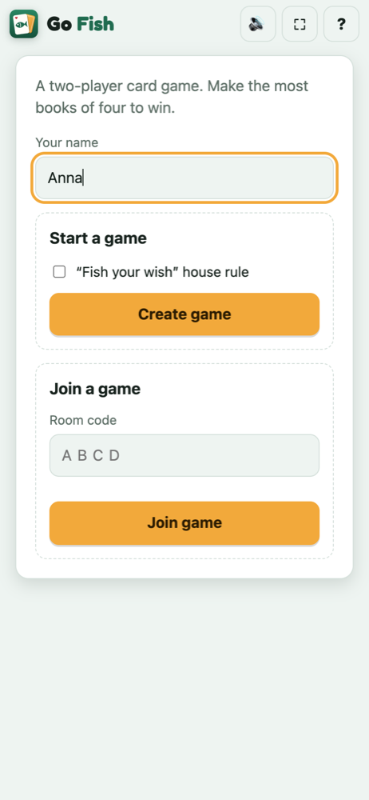
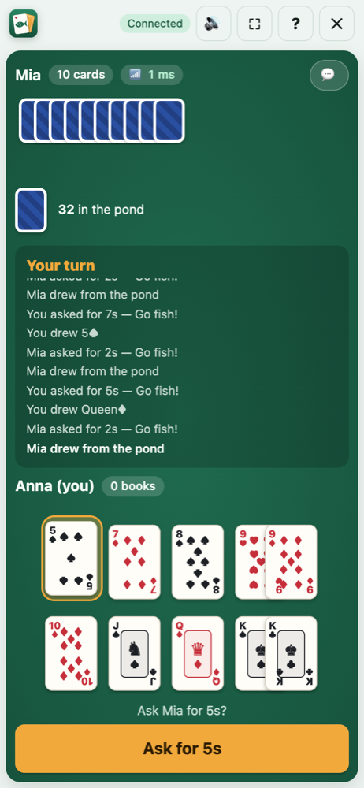
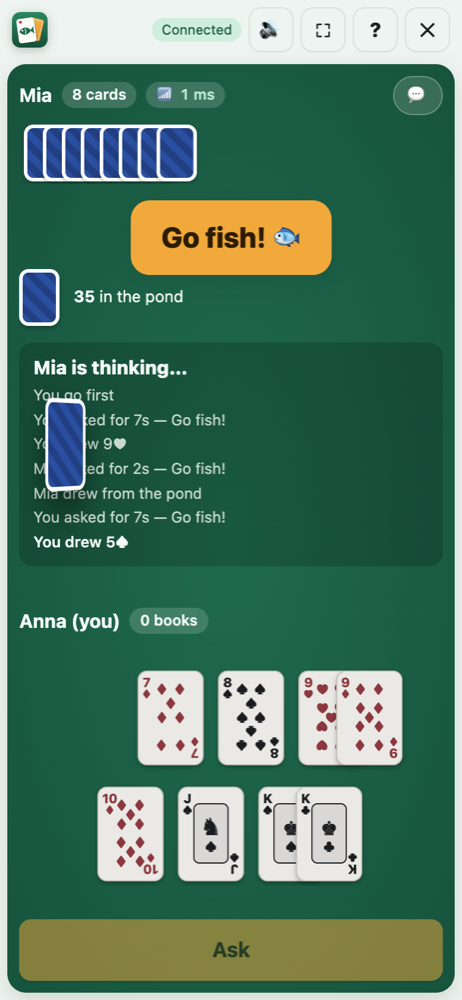
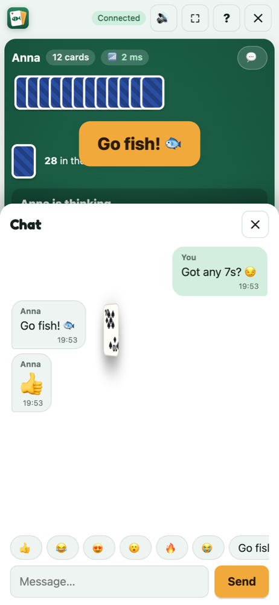
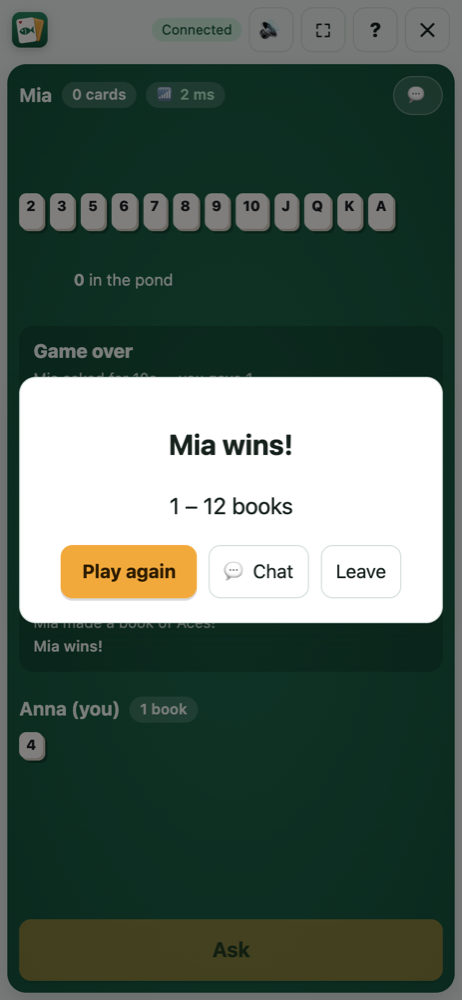

# Go Fish — Online for Two

A browser-based Go Fish card game for two people on different devices. You don't need to sign up or install anything, and there's no server: the two browsers connect directly to each other over WebRTC.

**Play:** https://babaevvannageldi.github.io/go-fish/

## Screenshots
| Lobby | Your turn | Drawing from the pond |
|:---:|:---:|:---:|
|  |  |  |

| Chat | Game over |
|:---:|:---:|
|  |  |

## How to start a game
1. Player 1 opens the site, enters a name, and taps **Create game**. A 4-letter room code appears.
2. Player 1 taps **Copy invite link** and sends it to Player 2. Player 2 can also open the site and type the code.
3. Player 2 enters a name and taps **Join game**. The cards are dealt automatically.

If someone refreshes or briefly loses connection, the game resumes. The host's browser keeps the game state, so the host should keep their tab open.

## Features
- Real playing cards with suit pips and court-card faces
- Card-draw animation from the pond, with synthesized sound effects (toggle with the Sound button)
- In-game chat with quick emoji replies; history survives a refresh
- Live ping indicator (green under 150 ms, amber under 300 ms, red above)
- Built for phones: full-screen button, installable to your home screen (PWA), and the screen stays awake while you play
- Light and dark mode

## Rules
These are the official [Bicycle Cards](https://bicyclecards.com/how-to-play/go-fish) rules for two players:

- **Deal:** each player gets 7 cards. The rest form the **pond**.
- **Asking:** on your turn, ask your opponent for a rank you already hold.
  - If they have it, they give you **all** their cards of that rank and you **go again**.
  - If they don't, it's **"Go fish!"** You draw a card and your turn ends.
- **Books:** four of a kind make a **book**, which is laid down automatically. Completing a book lets you play again.
- **Empty hand:** if your hand is empty, you draw from the pond automatically.
- **Winning:** when all 13 books are made, the player with the most books wins.
- **Optional house rule, "Fish your wish":** if you draw the rank you asked for, you show it and go again.

## Technologies
| Area | Technology |
|---|---|
| Language | Vanilla **JavaScript** (ES modules), **HTML5**, **CSS3**, no framework and no build step |
| Multiplayer | **WebRTC** data channels via **[PeerJS](https://peerjs.com/)** 1.5.5 (peer-to-peer), with Google/Cloudflare **STUN** servers |
| Animation | **Web Animations API** (card flight and 3D flip), CSS transitions |
| Sound | **Web Audio API**: every sound is synthesized in code, with no audio files |
| Mobile | **Fullscreen API**, **Screen Wake Lock API**, **Vibration API**, `visualViewport`, safe-area insets |
| App install | **PWA** web app manifest and icons (add to home screen, full screen) |
| Storage | `localStorage` / `sessionStorage`, so a game survives a refresh |
| Graphics | Hand-made **SVG** logo, CSS-drawn cards and pips, **[Fredoka](https://fonts.google.com/specimen/Fredoka)** font |
| Testing | Node.js built-in test runner (`node:test`): 83 tests, including 6,000 simulated games. Real two-browser end-to-end runs with **Puppeteer** + Chrome |
| Hosting | **GitHub Pages** (free, static) |
| AI tooling | Built with **Claude Code**, using custom debugger and tester agents (`.claude/agents/`) |

## Architecture
```
index.html        single page (lobby, waiting room, table, dialogs)
styles.css        responsive, light/dark felt-table theme
src/engine.js     pure deterministic rules engine (seeded RNG, immutable updates, redacted views)
src/net.js        PeerJS host/guest sessions (host-authoritative, reconnect)
src/seat.js       guest-seat policy (only the first guest's clientId may retake the seat)
src/ui.js         DOM rendering (textContent only, so names can't inject HTML)
src/fx.js         card-flight animation, vibration, full screen, wake lock
src/sound.js      Web Audio sound effects (no audio files)
src/chat.js       chat messages: validation, history, rendering
src/ping.js       round-trip-time samples and quality rating
src/main.js       app controller: lobby, host/guest flows, persistence, rematch, chat, ping
icons/            logo and app icons; manifest.webmanifest makes it installable
tests/            node:test suites (rules, 6k-game simulations, networking with a fake peer, UI integration, chat, ping, static checks)
docs/PROMPT.md    the full build spec
.claude/agents/   the debugger and tester agents used to verify this project
```

**Networking:**
- The game creator is the **host**. Their browser holds the full game state, checks every move against the engine, and sends each player only what they're allowed to see.
- Your opponent's cards and the order of the pond never leave the host.
- The PeerJS public broker only helps the two browsers find each other. After that, game data flows peer-to-peer.

## Development
```bash
npm test        # node --test tests/*.test.js  (no dependencies)
npm start       # serve on http://localhost:8080
```

To test locally, open two browser windows: create a game in one and join from the other.

## Known limitation
WebRTC connects most networks through STUN alone. Some strict corporate or mobile-carrier NATs need a TURN relay, which this free setup doesn't include. If you can't connect, try a different Wi-Fi network or a phone hotspot.
